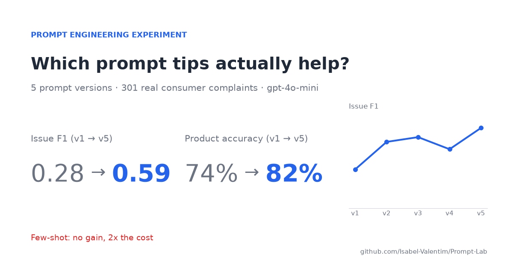
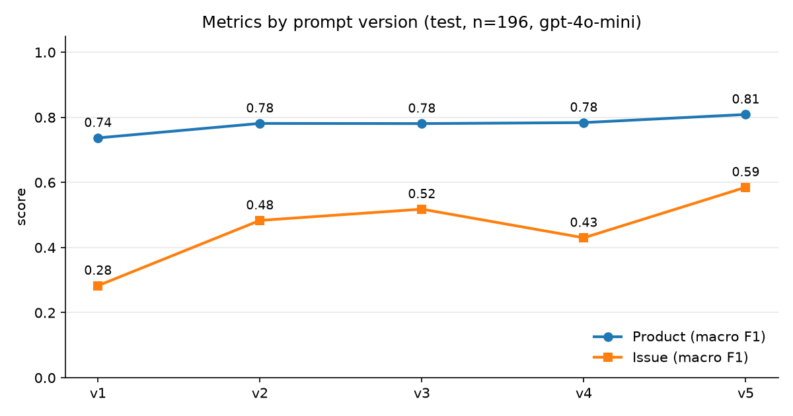
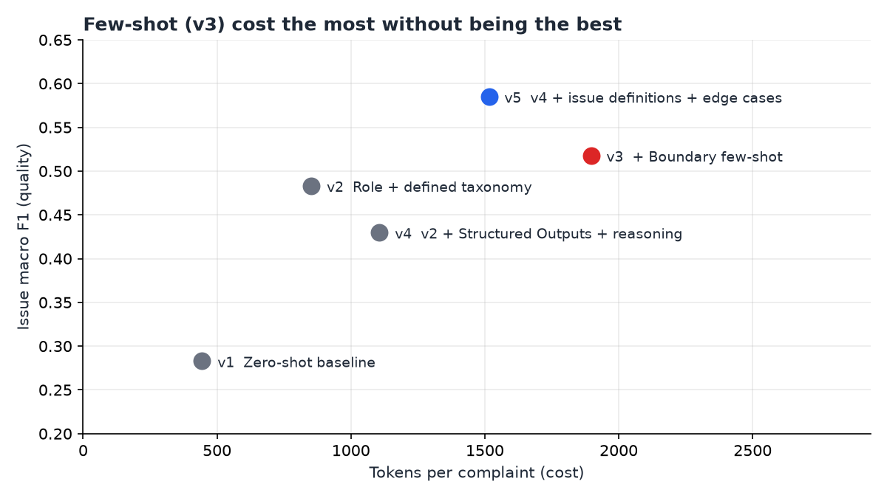

# Prompt Lab

[](README.pt-BR.md)



Every prompt engineering guide gives you the same list of tips: give the model a role, add examples, ask it to think step by step. I wanted to know how much each of those tips actually helps, so I tested them on real data instead of trusting the list.

This repo is that experiment. I wrote five versions of the same prompt, measured each one on 301 real consumer complaints, and kept a log of what I changed and why.

## The task

The data comes from the [CFPB](https://www.consumerfinance.gov/data-research/consumer-complaints/), the US agency that collects consumer complaints about banks, credit cards, loans and so on. Each complaint is free text written by a real person, and the CFPB labels it with a product and an issue.

The model (`gpt-4o-mini`) reads a complaint and has to do three things:

- say which product it's about (7 options, like credit card, mortgage or bank account)
- say what the issue is (11 options, one of them "Other")
- write a two-sentence summary in Portuguese, the kind a support agent in Brazil could read in five seconds

I used 105 complaints to develop the prompts and kept another 196 locked away until the very end. More on the data in [`data/DATA.md`](data/DATA.md).

## What happened



These are the numbers on the 196 test complaints, which no prompt version saw during development:

| Version | What I changed | Product | Issue | Issue F1 | Summary (1-5) | Tokens/case |
|---|---|---|---|---|---|---|
| v1 | Nothing, just the labels | 74.0% | 24.5% | 0.283 | 3.68 | 444 |
| v2 | Role + defined taxonomy | 78.1% | 51.5% | 0.483 | 4.25 | 852 |
| v3 | + Boundary few-shot | 78.1% | 52.0% | 0.518 | 4.17 | 1896 |
| v4 | v2 + Structured Outputs + reasoning | 79.1% | 45.9% | 0.430 | 4.17 | 1107 |
| v5 | v4 + issue definitions + edge cases | 81.6% | 56.6% | 0.585 | 4.17 | 1516 |

The first version was as simple as I could make it: "classify this complaint" plus the list of labels. It got the product right 74% of the time, but the issue only 24% of the time. When I read the errors, I saw that the model never answered "Other", even though that's the right answer for 4 out of 10 complaints. It also mixed issues with products that don't go together. Looking at the data, I found out that in the CFPB taxonomy each issue belongs to exactly one product. The model had no way of knowing that.

So in v2 I explained the taxonomy: what each product means and which issues are valid for each one. Issue accuracy doubled. That was the biggest jump in the whole experiment, and it came from reading errors, not from a clever technique.

In v3 I tried few-shot, adding seven real examples of the cases the model was confusing. It didn't help, and every call got twice as expensive. I dropped it and went back to v2.



In v4 I turned on Structured Outputs (so the model can only answer with valid labels) and asked for a short line of reasoning before the answer. The product got a little better, but the issue got worse. Reading the reasoning, I saw the model talking itself into a specific issue when the honest answer was "Other".

In v5 I kept the reasoning but gave it better criteria: a definition for each issue, with a note on when *not* to use it, and the instruction to start from "Other" and only move away from it if a definition clearly fits. This was the best version on everything.

Every hypothesis, change and result is written down in [`prompts/CHANGELOG.md`](prompts/CHANGELOG.md). The files in `prompts/` are templates; to read the exact text the model received for each version, including the few-shot examples, see [`prompts/rendered/`](prompts/rendered/). What v5 still gets wrong is in [`docs/error-analysis.md`](docs/error-analysis.md).

## What I took from it

The tips aren't wrong, but they're not free. Few-shot did nothing for this task, and step-by-step reasoning helped one part while hurting the other. If I hadn't measured, both would still be in the prompt, costing money and making things worse.

What actually moved the numbers was boring: reading the model's mistakes one by one and asking why.

I also learned to be careful with the ceiling. On the CFPB form, the consumer picks the label, not an analyst. Some of the model's "errors" are cases where I'd agree with the model over the label.

## Try it on your own prompt

You don't need this dataset to use the method. It works for any prompt that classifies or extracts something:

1. Get 100 to 300 real examples with the right answer. Set a third of them aside and don't look at them until the end.
2. Write the simplest prompt you can and measure it. That's your baseline.
3. Read the mistakes. Not the score, the actual mistakes. Look for patterns.
4. Change one thing at a time, measure again, and write down what happened, even when it gets worse.
5. Drop anything that doesn't improve the number. It's only adding cost.
6. When you stop improving, run every version once on the examples you set aside.

To reuse this repo, replace the files in `data/` and the prompts in `prompts/` with your own.

## Running it

```bash
pip install -r requirements.txt
cp .env.example .env               # add your OPENAI_API_KEY
python src/run_eval.py --prompt v5 --split test --judge
```

Other useful commands:

```bash
python data/fetch_cfpb.py                        # rebuild the sample from the sources (~670 MB download)
python src/run_eval.py --prompt all --split dev  # run every version on the dev set
python src/report.py --split test                # regenerate the table and the metrics chart
python src/figures.py                            # regenerate the cover and the cost vs. quality chart
python src/show_prompt.py                        # write the exact prompts sent to the model into prompts/rendered/
pytest                                           # tests, no API key needed
```

Responses are cached in `.cache/`, so running the same thing twice costs nothing. Running all five versions on the test set cost me about US$ 0.21.

The prompts live in `prompts/`, the evaluation code in `src/`, and every prediction behind the table above is in `results/`.

## Caveats

With 196 test cases, a difference of 1 or 2 points is just noise. The jump from v1 to v5 isn't.

The summaries are graded by `gpt-4o-mini` itself, using a rubric. That's good enough to compare versions, but I wouldn't use the score as an absolute measure of quality. It never flagged a single made-up fact, which makes me trust it less on that point, not more.

---

Made by Isabel Valentim. Data from the CFPB (public domain). MIT License.
