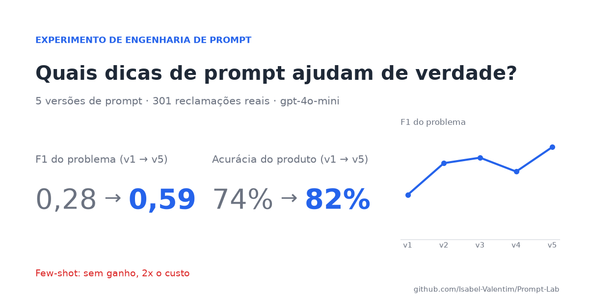
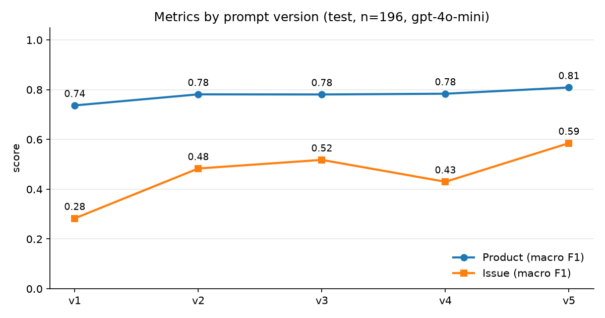
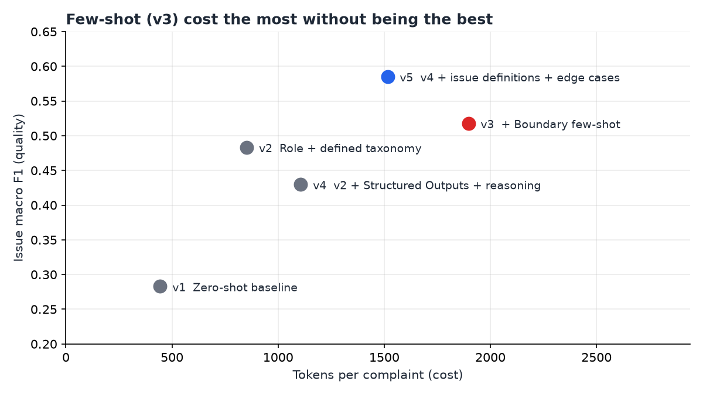

# Prompt Lab

[](README.md)



Todo guia de engenharia de prompt traz a mesma lista de dicas: dê um papel ao modelo, coloque exemplos, peça para ele pensar passo a passo. Eu queria saber quanto cada uma dessas dicas ajuda de verdade, então testei com dados reais em vez de confiar na lista.

Este repositório é esse experimento. Escrevi cinco versões do mesmo prompt, medi cada uma em 301 reclamações reais de consumidores e anotei o que mudei e por quê.

## A tarefa

Os dados vêm do [CFPB](https://www.consumerfinance.gov/data-research/consumer-complaints/), o órgão americano que recebe reclamações de consumidores sobre bancos, cartões, empréstimos e afins. Cada reclamação é um texto livre escrito por uma pessoa real, e o CFPB a classifica por produto e por problema.

O modelo (`gpt-4o-mini`) lê a reclamação e precisa fazer três coisas:

- dizer de qual produto ela trata (7 opções, como cartão de crédito, financiamento imobiliário ou conta bancária)
- dizer qual é o problema (11 opções, uma delas "Other")
- escrever um resumo de duas frases em português, do tipo que um atendente lê em cinco segundos

Usei 105 reclamações para desenvolver os prompts e guardei outras 196 até o final. Mais sobre os dados em [`data/DATA.md`](data/DATA.md) (em inglês).

## O que aconteceu



Estes são os números nas 196 reclamações de teste, que nenhuma versão viu durante o desenvolvimento:

| Versão | O que mudei | Produto | Problema | F1 do problema | Resumo (1-5) | Tokens/caso |
|---|---|---|---|---|---|---|
| v1 | Nada, só a lista de rótulos | 74,0% | 24,5% | 0,283 | 3,68 | 444 |
| v2 | Papel + taxonomia explicada | 78,1% | 51,5% | 0,483 | 4,25 | 852 |
| v3 | + Exemplos (few-shot) | 78,1% | 52,0% | 0,518 | 4,17 | 1896 |
| v4 | v2 + Structured Outputs + raciocínio | 79,1% | 45,9% | 0,430 | 4,17 | 1107 |
| v5 | v4 + definições dos problemas + casos de borda | 81,6% | 56,6% | 0,585 | 4,17 | 1516 |

A primeira versão era a mais simples possível: "classifique esta reclamação" e a lista de rótulos. Ela acertava o produto 74% das vezes, mas o problema só 24%. Lendo os erros, vi que o modelo nunca respondia "Other", que é a resposta certa em 4 de cada 10 reclamações. Ele também juntava problemas com produtos que não combinam. Olhando os dados, descobri que na taxonomia do CFPB cada problema pertence a um único produto. O modelo não tinha como saber disso.

Então, na v2, expliquei a taxonomia: o que cada produto significa e quais problemas valem para cada um. A acurácia do problema dobrou. Foi o maior salto do experimento inteiro, e ele veio de ler os erros, não de uma técnica sofisticada.

Na v3 testei few-shot, colocando sete exemplos reais dos casos que o modelo confundia. Não ajudou, e cada chamada ficou duas vezes mais cara. Descartei e voltei para a v2.



Na v4 ativei Structured Outputs (assim o modelo só consegue responder com rótulos válidos) e pedi uma linha de raciocínio antes da resposta. O produto melhorou um pouco, mas o problema piorou. Lendo o raciocínio, vi o modelo se convencendo de um problema específico quando a resposta honesta era "Other".

Na v5 mantive o raciocínio, mas dei critérios melhores: uma definição para cada problema, dizendo também quando *não* usar, e a instrução de começar por "Other" e só trocar se alguma definição se encaixar claramente. Foi a melhor versão em tudo.

Cada hipótese, mudança e resultado está anotado em [`prompts/CHANGELOG.md`](prompts/CHANGELOG.md). Os arquivos de `prompts/` são modelos; o texto exato que o modelo recebeu em cada versão, incluindo os exemplos do few-shot, está em [`prompts/rendered/`](prompts/rendered/). O que a v5 ainda erra está em [`docs/error-analysis.md`](docs/error-analysis.md). Os dois estão em inglês.

## O que eu tirei disso

As dicas não estão erradas, mas também não são de graça. O few-shot não fez nada por essa tarefa, e o raciocínio passo a passo ajudou numa parte e atrapalhou na outra. Se eu não tivesse medido, os dois continuariam no prompt, custando dinheiro e piorando o resultado.

O que mexeu nos números foi uma coisa nada glamourosa: ler os erros do modelo um por um e perguntar por quê.

Também aprendi a tomar cuidado com o teto. No formulário do CFPB, quem escolhe o rótulo é o próprio consumidor, não um analista. Em alguns dos "erros" do modelo, eu concordaria com o modelo e não com o rótulo.

## Teste no seu próprio prompt

Você não precisa desses dados para usar o método. Ele funciona para qualquer prompt que classifica ou extrai alguma coisa:

1. Junte de 100 a 300 exemplos reais com a resposta certa. Separe um terço e não olhe para eles até o final.
2. Escreva o prompt mais simples que conseguir e meça. Essa é a sua linha de base.
3. Leia os erros. Não a nota, os erros mesmo. Procure padrões.
4. Mude uma coisa de cada vez, meça de novo e anote o que aconteceu, inclusive quando piorar.
5. Descarte o que não melhora o número. Só está aumentando o custo.
6. Quando parar de melhorar, rode todas as versões uma única vez nos exemplos que você separou.

Para reaproveitar este repositório, troque os arquivos de `data/` e os prompts de `prompts/` pelos seus.

## Como rodar

```bash
pip install -r requirements.txt
cp .env.example .env               # coloque sua OPENAI_API_KEY
python src/run_eval.py --prompt v5 --split test --judge
```

Outros comandos úteis:

```bash
python data/fetch_cfpb.py                        # recria a amostra a partir das fontes (~670 MB de download)
python src/run_eval.py --prompt all --split dev  # roda todas as versões no conjunto de desenvolvimento
python src/report.py --split test                # gera de novo a tabela e o gráfico de métricas
python src/figures.py                            # gera de novo a capa e o gráfico de custo × qualidade
python src/show_prompt.py                        # escreve em prompts/rendered/ os prompts exatos enviados ao modelo
pytest                                           # testes, não precisa de chave de API
```

As respostas ficam em cache em `.cache/`, então rodar a mesma coisa duas vezes não custa nada. Rodar as cinco versões no conjunto de teste me custou cerca de US$ 0,21.

Os prompts ficam em `prompts/`, o código de avaliação em `src/`, e todas as previsões por trás da tabela acima estão em `results/`.

## Ressalvas

Com 196 casos de teste, uma diferença de 1 ou 2 pontos é só ruído. O salto da v1 para a v5 não é.

Quem dá nota aos resumos é o próprio `gpt-4o-mini`, seguindo uma rubrica. Isso basta para comparar versões, mas eu não usaria a nota como medida absoluta de qualidade. Ele nunca apontou um único fato inventado, e isso me faz confiar menos nele nesse ponto, não mais.

---

Feito por Isabel Valentim. Dados do CFPB (domínio público). Licença MIT.
